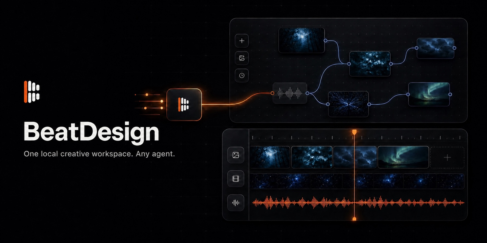

<p align="center">
  
</p>

<p align="center">
    <a href="https://linux.do" alt="LINUX DO">
        </a>
</p>

<h1 align="center">BeatDesign</h1>

<p align="center">
  <strong>在本地运行的 Higgsfield 开源替代方案</strong><br />
  在无限 Canvas 上组织图片与视频工作流，在浏览器 Editor 中完成剪辑，也可以让任何支持 MCP 的 Agent 操作同一个 Project。
</p>

<p align="center">
  <a href="https://beatapi.io/design">网站</a> ·
  <a href="#快速开始">快速开始</a> ·
  <a href="#让-agent-操作-beatdesign">MCP</a> ·
  <a href="./docs/PRODUCT_PLAN_AND_STATUS.md">产品状态</a>
</p>

<p align="center">
  <a href="./README.md">English</a> ·
  <strong>简体中文</strong> ·
  <a href="./README.ja.md">日本語</a>
</p>

BeatDesign 是一个独立、开源、本地优先的 AI 图片与视频创作工作台。它适合喜欢 Higgsfield 这类连贯创作流程，同时希望在自己的电脑上运行、检查和扩展工作空间的人。

## 最新版本 · v0.2.5 · 2026 年 10 月

以下更新已发布至 [GitHub Release v0.2.5](https://github.com/BeatAPI/BeatDesign/releases/tag/v0.2.5) 和 `@beatapi/beatdesign-workbuddy@0.2.5`。WorkBuddy 市场审核与上架状态单独跟踪。

已有源码用户请先停止 BeatDesign，再依次运行 `git pull --ff-only`、`pnpm install --frozen-lockfile`、`pnpm db:push`，随后重启 `pnpm dev:agent`（或原有 UI/MCP 启动命令）。保留本地数据目录，无需重装或重置项目。

- **项目设置与稳定封面：** 修改项目名称和简介，上传或选择封面，或恢复自动封面。手动封面不会被后续导入、生成的素材替换。入口在项目卡片和工作区顶栏的设置图标。
- **生成版本保持一致：** 画布预览和 Take 选择默认指向最新成功结果，同时保留手动选择和时间线锁定的具体素材。
- **创建项目一步直达：** 选择画布或创作台后直接进入新项目，支持失败重试和重复点击保护。
- **修复导出音量：** MCP 时间线导出保留顺序片段的音量，叠加音频增加峰值保护。
- **30 个 MCP 工具：** Agent 可通过与 UI 相同、带版本校验的命令修改项目设置。同时改进画布撤销／重做到空白状态的保存、Windows 测试兼容性和窄屏布局。

此前已支持尾帧续写、画布到剪辑的连续流程、图片叠层、带样式的 SRT 字幕、浏览器 MP4 导出和 MCP 时间线导出。浏览器导出不依赖系统 FFmpeg；MCP 抽帧需要 `ffmpeg`，MCP 时间线导出还需要 `ffprobe`。

[更新详情](./CHANGELOG.md) · [项目设置说明](./docs/PROJECT_SETTINGS.md) · [当前能力与后续规划](./docs/PRODUCT_PLAN_AND_STATUS.md)

当前源码（尚未正式发版）新增持久画布分组与排列、素材文件夹、固定版本 Elements 和本机工作流模板，MCP 共 38 个工具；v0.2.5 npm 包仍为 30 个。[功能说明](./docs/PROJECT_ORGANIZATION.md)。

## 两种核心创作模式，一个 Project

### 无限 Canvas

放入提示词、图片、视频和音频。连接节点、创建分支、比较生成结果、复用素材，把完整的视觉工作流保留在同一个项目里。

### 视频 Editor

把 Canvas 结果送入本地时间线。你可以裁剪、分割、移动、混合音频、放置和调整图片叠层、设置 SRT 字幕样式、创建 AI 备选 Take，并在浏览器中预览和导出 MP4。

Studio 提供更专注的单次生成入口。Assets 让导入和生成的文件在 Canvas、Editor 与 MCP 之间持续可用。

## 为什么选择 BeatDesign

- **默认保存在本地。** 项目、媒体、Canvas 状态、时间线和生成历史都留在本地工作空间。
- **Canvas 与 Editor 连在一起。** 生成结果会成为可复用的项目 Asset，不会困在某个单独工具里。
- **可以使用自己的 Agent。** Codex、Claude Code、Cursor 和其他 MCP Host 可以读取并修改浏览器里正在使用的同一个 Project。
- **自行配置生成服务。** BeatAPI 是内置 Provider。本地导入、排列、剪辑、预览和导出不需要 API Key。
- **适合继续扩展。** Provider Adapter、项目存储和 Command Kernel 都有明确的扩展边界。

## 从想法到完整视频

```text
提示词或本地媒体
        ↓
无限 Canvas ─── 连接、生成、分支、比较
        ↓
共享 Assets ─── 图片、视频、音频、派生片段
        ↓
视频 Editor ─── 裁剪、排列、预览、导出 MP4
        ↑
任意 MCP Agent ─ 操作同一个本地 Project
```

## 快速开始

需要 Node.js 22+、`pnpm` 10+，以及 macOS 或 Windows 上的新版 Chrome。

```bash
pnpm install
pnpm db:push
pnpm dev
```

打开 [http://127.0.0.1:3020](http://127.0.0.1:3020)。

只有在生成、分析媒体或使用 AI 重做时，才需要添加自己的 [BeatAPI API Key](https://beatapi.io/dashboard/apikeys)。选择本地文件不会自动上传到 Provider。

### 选择启动方式

| 命令 | 启动内容 |
| --- | --- |
| `pnpm dev` | 可视化工作空间 |
| `pnpm dev:agent` | 可视化工作空间与本地 HTTP MCP Endpoint |
| `pnpm mcp` | 面向编程 Agent 的 stdio MCP Server |

## 让 Agent 操作 BeatDesign

当前源码提供 38 个本地 MCP 工具（v0.2.5 发布包为 30 个），覆盖 Skill、Project、Asset、Canvas、生成和 Editor 操作，包括发现内置 Skill 目录以及从权威时间线导出 MP4。Agent 修改会经过同一套项目服务，并显示在浏览器工作空间中。

连接 MCP Host 后，可以直接提出这样的要求。

> 打开我最近的 BeatDesign 项目，把这些片段加入时间线，放置品牌图片叠层，调整字幕，然后把 Editor 停在方便我检查的位置。

## 平台兼容性

| 编程 Agent / 平台 | 状态 | 快速接入 |
| --- | --- | --- |
| [Claude Code](./integrations/claude-code/beatdesign/README.md) | ✅ 已支持 | [插件或 MCP 配置](./integrations/claude-code/) |
| [Codex](./integrations/codex/beatdesign/README.md) | ✅ 已支持 | [插件配置](./integrations/codex/beatdesign/README.md) |
| [ZCode](./integrations/zcode/config.example.json) | ✅ 已支持 | [MCP 配置](./integrations/zcode/config.example.json) |
| [OpenCode](./integrations/opencode/) | ✅ 已支持 | [MCP 配置](./integrations/opencode/) |
| [Cursor](./integrations/cursor/mcp.json.example) | ✅ 已支持 | [MCP 配置](./integrations/cursor/mcp.json.example) |
| [Windsurf](./integrations/windsurf/mcp_config.json.example) | ✅ 已支持 | [MCP 配置](./integrations/windsurf/mcp_config.json.example) |
| [VS Code + GitHub Copilot](./integrations/vscode/mcp.json.example) | ✅ 已支持 | [MCP 配置](./integrations/vscode/mcp.json.example) |
| [Cline / Roo Code](./integrations/cline/mcp_settings.json.example) | ✅ 已支持 | [MCP 配置](./integrations/cline/mcp_settings.json.example) |
| [Qwen Code](./integrations/qwen/settings.example.json) | ✅ 已支持 | [MCP 配置](./integrations/qwen/settings.example.json) |
| [Gemini CLI](./integrations/gemini/settings.example.json) | ✅ 已支持 | [MCP 配置](./integrations/gemini/settings.example.json) |
| [Hermes Agent](./integrations/hermes/config.yaml.snippet) | ✅ 已支持 | [MCP 配置](./integrations/hermes/config.yaml.snippet) |
| [Kiro](./integrations/kiro/mcp.json.example) | ✅ 已支持 | [MCP 配置](./integrations/kiro/mcp.json.example) |
| [Trae](./integrations/trae/mcp.json.example) | ✅ 已支持 | [MCP 配置](./integrations/trae/mcp.json.example) |
| [WorkBuddy](./integrations/workbuddy/beatdesign/README.md) | ✅ 已支持 | [Connector 配置](./integrations/workbuddy/beatdesign/README.md) |
| [QwenWork](./integrations/qwenwork/mcp.json.example) | ✅ 已支持 | [HTTP Connector](./integrations/qwenwork/mcp.json.example) |
| [Doubao Work](./integrations/doubao-work/mcp.json.example) | ✅ 已支持 | [HTTP Connector](./integrations/doubao-work/mcp.json.example) |

[查看完整的 Agent 接入指南 →](./integrations/README.md)

## 当前已经支持

- 图片与视频生成，以及 Standard 和 Deep 视频分析。
- Canvas 上的图片、视频、音频、生成、Timeline 和文本节点。
- Studio、Canvas、Editor 与 MCP 共用的 Project Assets。
- 支持图片、视频、音频、可移动图片叠层和带样式 SRT 字幕轨的非破坏式时间线编辑。
- 使用 WebCodecs 与 Mediabunny 完成本地预览和浏览器端 H.264/AAC MP4 导出。
- 英文、中文和日文界面。
- 本地 stdio 与 Streamable HTTP MCP Transport。

BeatDesign 当前专注本地短视频创作。在线协作、多个命名 Timeline、高级转场、变速、波形和桌面安装包仍不属于当前版本。

[查看完整的已完成能力与规划边界 →](./docs/PRODUCT_PLAN_AND_STATUS.md)

## 项目文档

- [产品状态](./docs/PRODUCT_PLAN_AND_STATUS.md)
- [MCP 接入](./docs/MCP.md)
- [系统架构](./docs/ARCHITECTURE.md)
- [Provider 接入](./docs/PROVIDERS.md)
- [参与贡献](./.github/CONTRIBUTING.md)
- [安全说明](./.github/SECURITY.md)

## License

BeatDesign 使用 [Apache License 2.0](./LICENSE)。BeatAPI 与 BeatDesign 商标、第三方模型访问和仓库内第三方组件分别遵循各自条款。详情见[第三方声明](./third_party/)与[商标政策](./docs/TRADEMARKS.md)。
